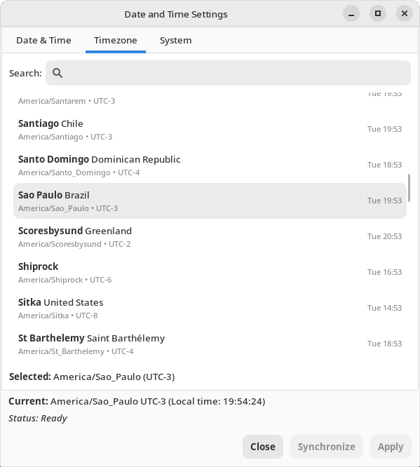
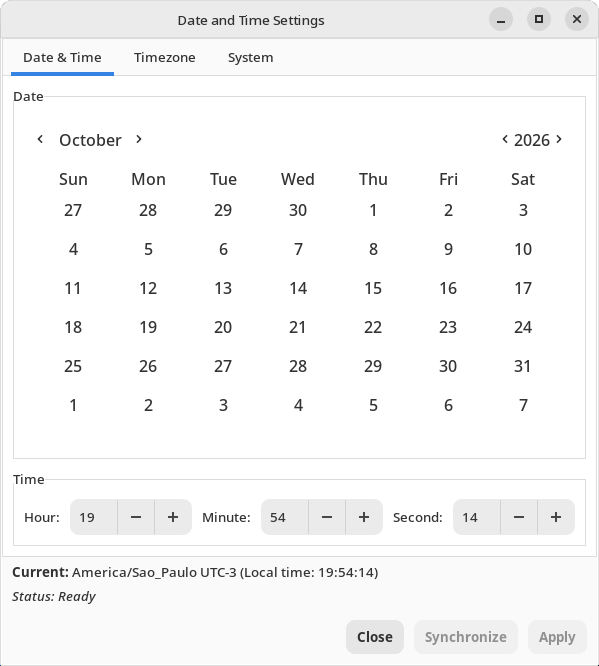
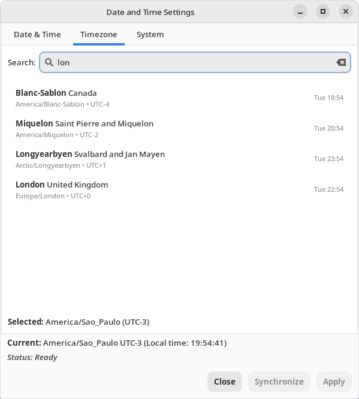
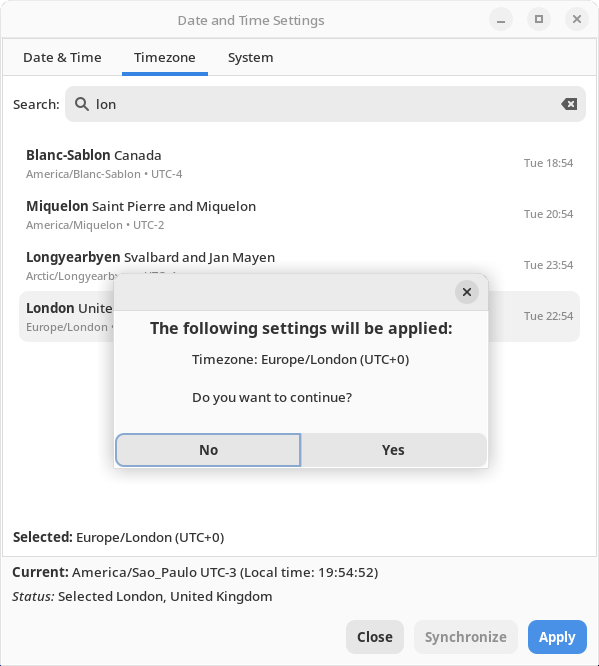
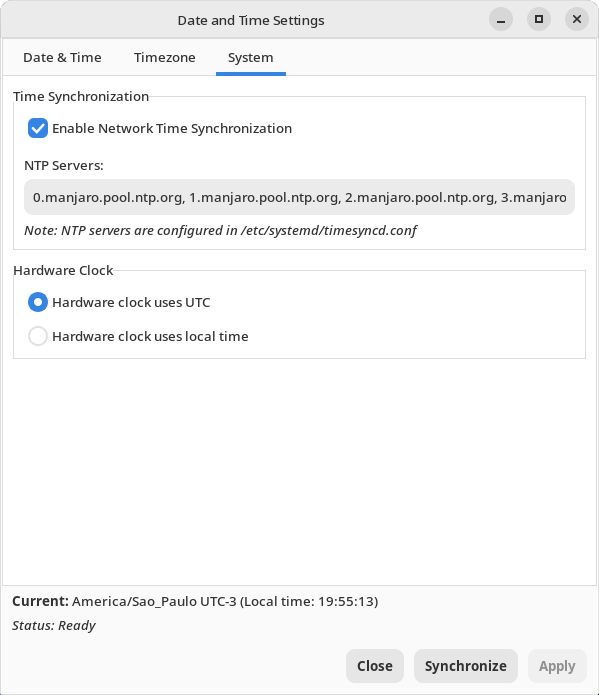

<div align="center">


# XFCE DateTime Tool

**A simple and safe way to set the date, time and timezone on XFCE desktops.**

[](LICENSE)
[](https://www.python.org/)
[](https://www.gtk.org/)
[](https://www.xfce.org/)
[](https://archlinux.org/)
[](locale/)
[](https://sonarcloud.io/summary/new_code?id=big-comm_comm-xfce-datetime)
[](https://github.com/big-comm/comm-xfce-datetime/commits/main)



</div>

---

## Overview

**XFCE DateTime Tool** (`comm-xfce-datetime`) is a GTK 3 application developed by the
[BigCommunity](https://github.com/big-comm) for Arch Linux based distributions such as
BigLinux and BigCommunity. It brings date, time, timezone, network time synchronization
and hardware clock settings together in one small window, and applies them through
`systemd-timedated`, the same service used by `timedatectl`.

All changes are made only when you press **Apply**, after a confirmation that lists exactly
what will change, and with a single administrator password prompt.

## Features

- **Date and time** — pick the date in a calendar and set hours, minutes and seconds.
  The fields follow the live clock until you edit them.
- **Timezone** — every timezone known by the system, with country name, UTC offset and
  current local time. The current timezone is preselected.
- **Fast search** — find a timezone by city, country or region; accents are ignored
  (`sao` finds *São Paulo*, `lon` finds *London*).
- **Network time synchronization (NTP)** — enable or disable it, see the NTP servers in use
  and force an immediate synchronization.
- **Hardware clock** — choose whether the RTC keeps UTC or local time (useful for dual boot
  with Windows).
- **Safe by design**
  - Changing only the timezone never changes the system clock.
  - A manually entered time is interpreted in the timezone being applied and keeps running
    while the password prompt is open.
  - The **Apply** button is enabled only when something differs from the system settings.
- **One password prompt** — all changes are applied by a small root helper with its own
  polkit action, instead of one prompt per setting.
- **Responsive** — privileged operations run asynchronously; the window never freezes.
- **Translated** — available in 27 languages, including the polkit prompt and the menu entry.
- **XFCE integration** — the panel clock is refreshed automatically after a timezone change.

## Screenshots

| Date & Time | Timezone search |
|:---:|:---:|
|  |  |
| **Confirmation before applying** | **System settings** |
|  |  |

## Installation

### From the BigCommunity repositories

```bash
sudo pacman -S comm-xfce-datetime
```

### Building from source

The `PKGBUILD` clones this repository, installs the application and compiles the translations.

```bash
git clone https://github.com/big-comm/comm-xfce-datetime.git
cd comm-xfce-datetime/pkgbuild
makepkg -si
```

### Requirements

| Package | Purpose |
|---|---|
| `python` ≥ 3.9 | Application runtime (uses `zoneinfo`) |
| `python-gobject`, `gtk3` | User interface |
| `systemd` | `systemd-timedated` and `systemd-timesyncd` |
| `polkit` | Authorization (`pkexec`); a polkit agent must be running in the session |
| `gettext` | Build only — compiles the translations |
| `iso-codes` | Optional — translated country names in the timezone list |

## Usage

Open **XFCE DateTime Tool** from the application menu (*Settings*) or run:

```bash
comm-xfce-datetime
```

1. Adjust the settings in the **Date & Time**, **Timezone** and **System** tabs.
2. Press **Apply** and review the summary of changes.
3. Confirm and enter the administrator password once.

**Synchronize** restarts the NTP service and waits for a new time reply. It is available while
network time synchronization is enabled.

## How it works

```text
+----------------------+   D-Bus (read)   +-------------------+
|  comm-xfce-datetime  | ---------------> | systemd-timedated |
|  (GTK 3, user)       |                  | systemd-timesyncd |
+----------+-----------+                  +-------------------+
           |                                        ^
           | pkexec (one password prompt)           | timedatectl
           v                                        |
+--------------------------------------------+      |
| /usr/lib/comm-xfce-datetime/apply-settings | -----+
| (root helper, validates its arguments)     |
+--------------------------------------------+
```

- Current settings are read from `org.freedesktop.timedate1` and `org.freedesktop.timesync1`
  over D-Bus, without privileges.
- Changes are sent to the root helper through `pkexec`, using the polkit action
  `org.bigcommunity.comm-xfce-datetime.apply` (`auth_admin_keep`).
- The helper validates every argument (known timezone, boolean values, finite time offset)
  and calls `timedatectl` in a safe order: disable NTP → hardware clock → timezone → time →
  enable NTP.

## Project structure

```text
comm-xfce-datetime/
├── locale/                          # Translation template (.pot) and translations (.po)
├── pkgbuild/PKGBUILD                # Arch Linux package recipe
└── usr/
    ├── bin/comm-xfce-datetime       # Launcher
    ├── lib/comm-xfce-datetime/
    │   └── apply-settings           # Root helper run through pkexec
    └── share/
        ├── applications/            # Desktop entry
        ├── comm-xfce-datetime/      # Application (Python + GTK 3)
        └── polkit-1/actions/        # Polkit action
```

## Translations

Besides English, the interface is translated into 27 languages: Bulgarian, Chinese (Simplified),
Croatian, Czech, Danish, Dutch, Estonian, Finnish, French, German, Greek, Hebrew, Hungarian, Icelandic, Italian,
Japanese, Korean, Norwegian Bokmål, Polish, Portuguese (Brazil), Romanian, Russian, Slovak,
Spanish, Swedish, Turkish and Ukrainian.

Translations live in `locale/*.po` and are compiled into `.mo` files by the `PKGBUILD`.
After changing user-visible strings in the code, update the template and the catalogs:

```bash
xgettext -L Python -k_ --from-code=UTF-8 --package-name=comm-xfce-datetime \
    -o locale/comm-xfce-datetime.pot usr/share/comm-xfce-datetime/comm-xfce-datetime.py
for po in locale/*.po; do msgmerge -U --backup=none "$po" locale/comm-xfce-datetime.pot; done
```

Then translate the new entries and check them with `msgfmt -c locale/<lang>.po`.
Strings of the polkit action and the desktop entry are translated directly in their files.

## Contributing

Bug reports and pull requests are welcome. Please open an
[issue](https://github.com/big-comm/comm-xfce-datetime/issues) describing the problem or the
proposed change, and keep new user-visible strings translatable with `_()`.

## Credits

- Developed by the [BigCommunity](https://github.com/big-comm) team.
- Application icon from [bigicons-papient](https://github.com/biglinux/bigicons-papient)
  (GPL-3.0).

## License

This project is licensed under the MIT License — see the [LICENSE](LICENSE) file for details.
